# Neon Noir

A theme studio for [Paseo](https://paseo.sh). Pick one of 20 dark presets in five collections (Ink,
Neon, Terminal, Luxe, Frost), tune it with eight knobs, and let each preset bring its own pair of
fonts. Every setting stays dark and keeps its contrast guarantees. Mac and iPhone, stock Paseo, no
patches.

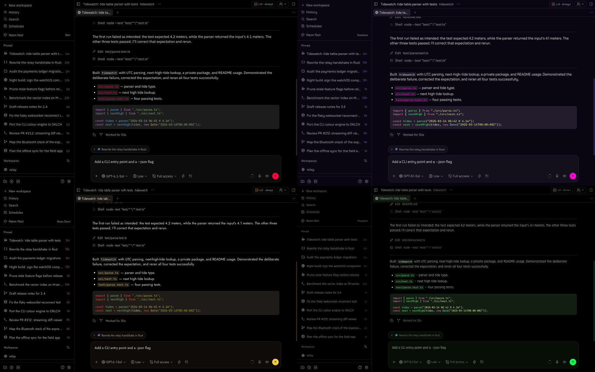

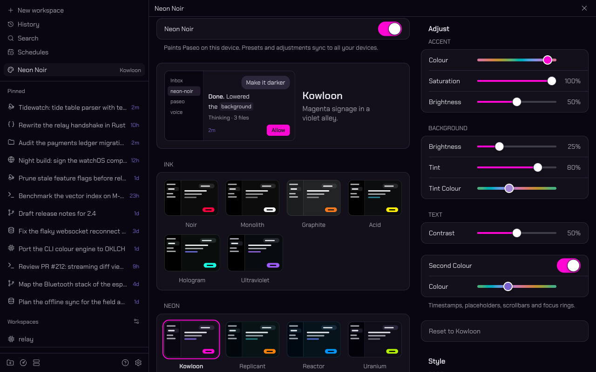

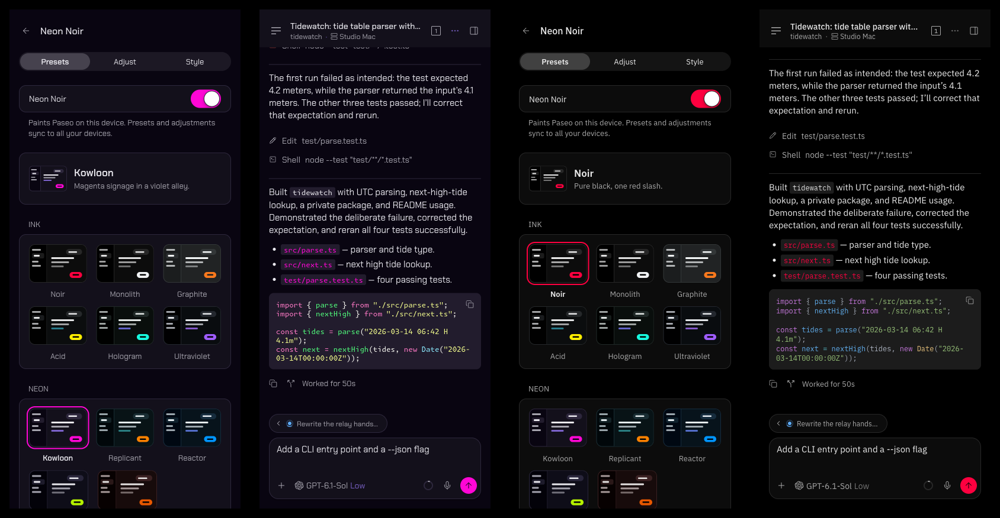

| | | |
| --- | --- | --- |
| 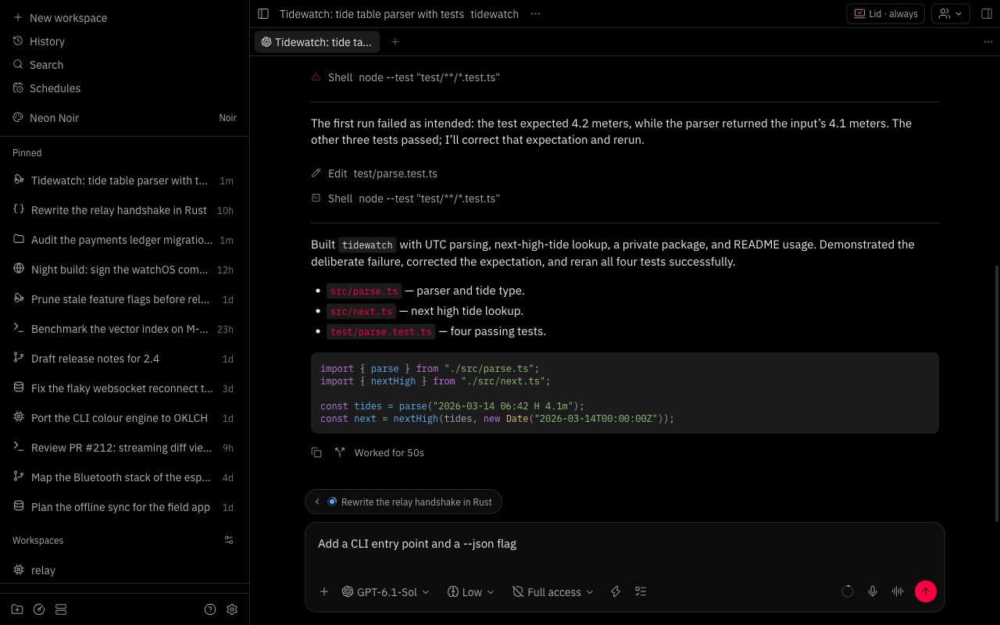 Noir | 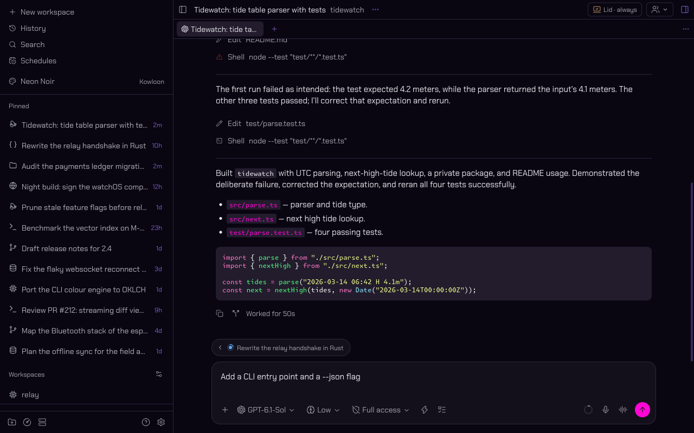 Kowloon | 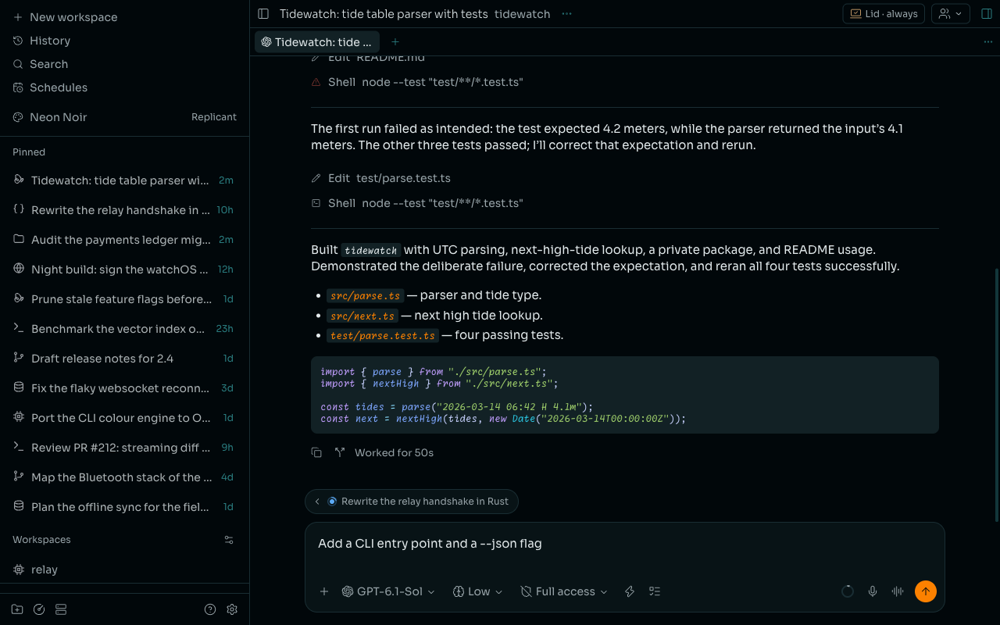 Replicant |
| 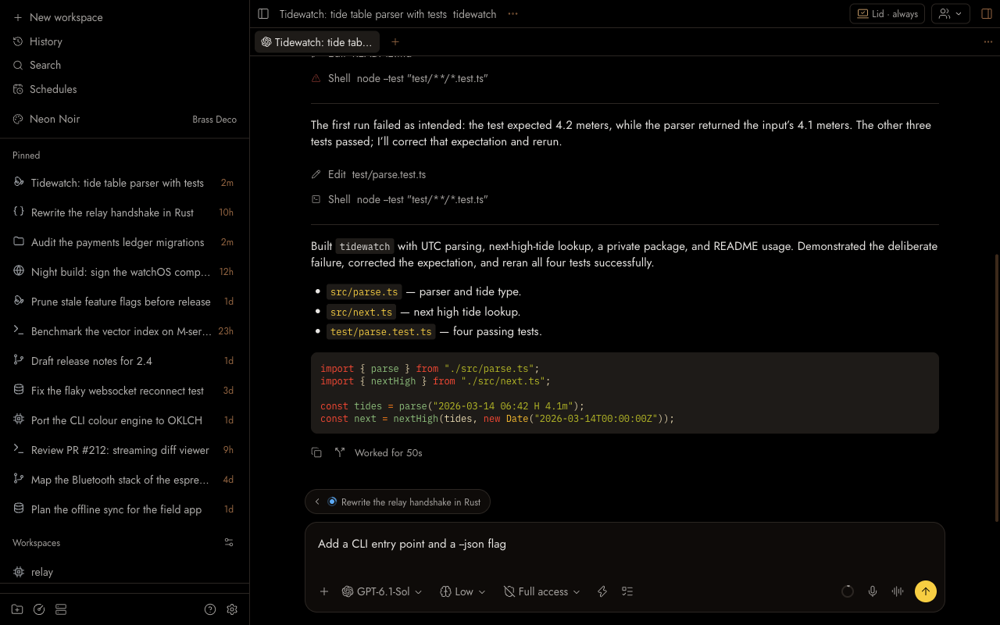 Brass Deco | 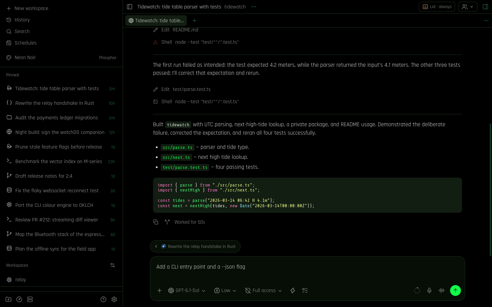 Phosphor | 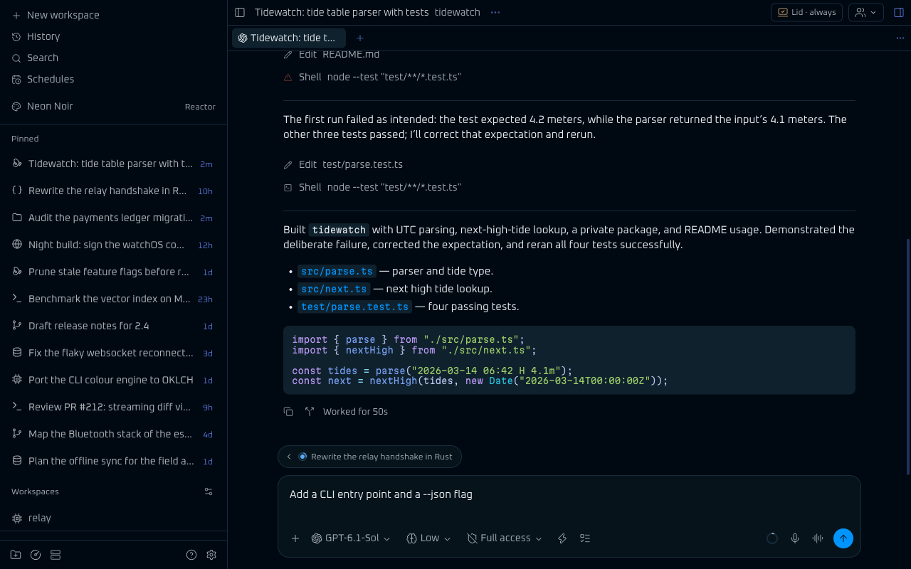 Reactor |
| 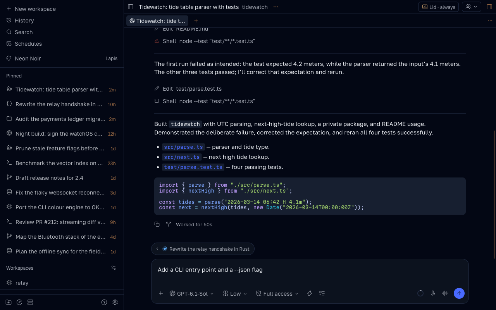 Lapis | 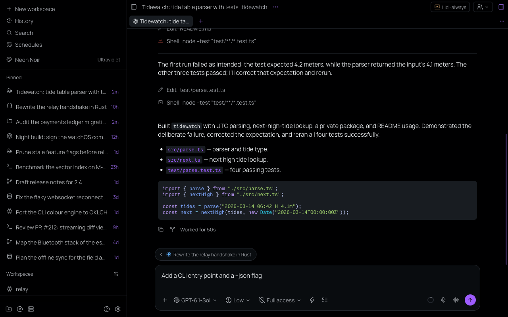 Ultraviolet | 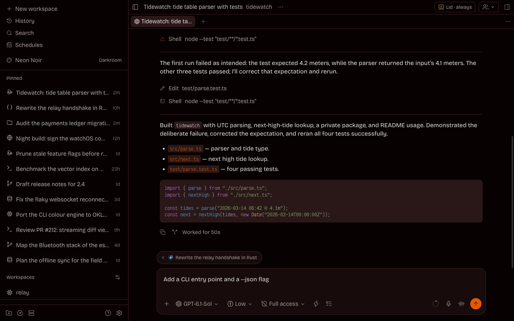 Darkroom |

The screenshots show Paseo's web client with an invented workspace; the phone frames are the same
client at phone width.

## Install

```sh
paseo plugin add github:devXpro/paseo-neon-noir
```

Or from a checkout: `paseo plugin add /absolute/path/to/paseo-neon-noir`. Paseo 0.13 or later.

## Use

Open **Neon Noir** in the sidebar and turn on the **Neon Noir** switch at the top of the studio, or
just tap a preset: the first tap turns the switch on. From then on the app follows every preset at
once and a slider when it is let go; the studio's preview follows the drag. The switch paints Paseo
on this device only; turning it off gives the device its
previous theme back and leaves its fonts and sizes alone. The sidebar row names the preset shown
here, or says _Off_.

Every preset keeps its own adjustments, so several can be tuned and switched between. The studio's
choice is kept by the host, so every app connected to it, the phone included, paints the same
preset and adjustments; whether an app shows Neon Noir at all is its own switch.

Should a device not take the switch (the studio then offers a reload), pick **Neon Noir** in
**Settings → Appearance** instead; it is listed as _Neon Noir · <preset>_.

## Presets

| Preset         | Collection | Accent    | Second hue             | Syntax      | Fonts                             | Tagline                                       |
| -------------- | ---------- | --------- | ---------------------- | ----------- | --------------------------------- | --------------------------------------------- |
| Noir           | Ink        | `#FE003F` | none                   | one         | IBM Plex Sans / IBM Plex Mono     | Pure black, one red slash.                    |
| Monolith       | Ink        | `#F0F2F4` | none                   | one         | Geist / Geist Mono                | Black slab, white light.                      |
| Graphite       | Ink        | `#FA791D` | none                   | one         | Barlow / JetBrains Mono           | A graphite instrument with one orange switch. |
| Acid           | Ink        | `#FFED00` | cyan ring              | dracula     | Space Grotesk / Space Mono        | Hazard yellow on cold ink.                    |
| Hologram       | Ink        | `#17FFE1` | indigo ring            | tokyo-night | Jura / Monaspace Krypton          | Aqua light with a violet fringe.              |
| Ultraviolet    | Ink        | `#9E5CFF` | none                   | tokyo-night | Manrope / Monaspace Neon          | One blacklight tube in a dark room.           |
| Kowloon        | Neon       | `#FF06D5` | violet ring and field  | dracula     | Chakra Petch / Monaspace Krypton  | Magenta signage in a violet alley.            |
| Replicant      | Neon       | `#FC8100` | cyan ring, azure field | tokyo-night | Sora / Monaspace Radon            | Orange neon over teal-black rain.             |
| Reactor        | Neon       | `#0095FE` | none                   | tokyo-night | Oxanium / Martian Mono            | Blue glow at the bottom of the pool.          |
| Uranium        | Neon       | `#B4F100` | violet field           | tokyo-night | Tektur / Kode Mono                | Antique glass, glowing from within.           |
| Darkroom       | Neon       | `#E65700` | red field              | one         | Bricolage Grotesque / Victor Mono | Prints rising under the safelight.            |
| Phosphor       | Terminal   | `#12FF4C` | none                   | dracula     | Rajdhani / Share Tech Mono        | Green glow on black glass.                    |
| Amber          | Terminal   | `#F4AD00` | none                   | gruvbox     | Play / Departure Mono             | A 1983 terminal, warm in the dark.            |
| Grid           | Terminal   | `#00E3FE` | none                   | tokyo-night | Exo 2 / 0xProto                   | Cyan wireframe on a dark void.                |
| Brass Deco     | Luxe       | `#F7CE42` | orange ring            | gruvbox     | Jost / IBM Plex Mono              | Polished brass on black lacquer.              |
| Lapis          | Luxe       | `#496AFF` | orange ring            | tokyo-night | Golos Text / Martian Mono         | Ultramarine stone with flecks of gold.        |
| Emerald Velvet | Luxe       | `#CCB142` | green field            | gruvbox     | Syne / Monaspace Xenon            | Green velvet, old gilt.                       |
| Oxblood        | Luxe       | `#E4D8C2` | rose field             | gruvbox     | Onest / Victor Mono               | Oxblood leather, ivory stitching.             |
| Arctic         | Frost      | `#2F98BF` | none                   | nord        | Inter / Fira Code                 | Polar night, breath on cold glass.            |
| Borealis       | Frost      | `#32C8A0` | indigo field           | nord        | Manrope / Cascadia Code           | Green light across a frozen sky.              |

The second hue is the ring or the surface tint where it sits 20° or more from the accent. Syntax is
the syntax highlighting theme that suits the preset; Paseo keeps it as a separate setting.
Fonts is the preset's interface / code pair (see [Fonts](#fonts)).
`node tools/readme-table.ts` prints this table from the presets as they are.

## Fonts

The studio's **Style** tab bundles 35 fonts: 19 for the interface, 16 for code. Turn on **Custom
Fonts**, then tap **Interface Font** or **Code Font** to open its gallery; each row shows the
family and a sample in its own face, with its style and script tags. With **Fonts Follow the Preset** (on by
default) picking a preset also picks its pair from the table above; picking a font by hand turns
it off. Paseo sets chat prose in the interface font too, so every pick stays a text face.

Every font is under the SIL Open Font License, with its licence file beside it in
`fonts/<id>/`. Interface fonts ship as one variable file or as Regular, Medium and SemiBold;
code fonts as one Regular (Victor Mono adds its cursive italic). _Cyrillic_ means the files hold
the whole Russian alphabet, Ё included. The desktop app loads the files from the host as
`@font-face` rules; on iPhone they are registered with the app's font loader, which is untested
on a device.

| Family              | Kind      | Scripts         | Tags                         | Source                     |
| ------------------- | --------- | --------------- | ---------------------------- | -------------------------- |
| Geist               | Interface | Latin, Cyrillic | Grotesk                      | vercel/geist-font          |
| Inter               | Interface | Latin, Cyrillic | Grotesk                      | rsms/inter                 |
| IBM Plex Sans       | Interface | Latin, Cyrillic | Grotesk, Industrial          | google/fonts               |
| Manrope             | Interface | Latin, Cyrillic | Geometric                    | google/fonts               |
| Jost                | Interface | Latin, Cyrillic | Geometric                    | google/fonts               |
| Golos Text          | Interface | Latin, Cyrillic | Grotesk                      | google/fonts               |
| Onest               | Interface | Latin, Cyrillic | Geometric                    | google/fonts               |
| Exo 2               | Interface | Latin, Cyrillic | Techno                       | google/fonts               |
| Play                | Interface | Latin, Cyrillic | Squared                      | google/fonts               |
| Jura                | Interface | Latin, Cyrillic | HUD                          | google/fonts               |
| Tektur              | Interface | Latin, Cyrillic | Squared, HUD                 | google/fonts               |
| Space Grotesk       | Interface | Latin           | Grotesk                      | google/fonts               |
| Chakra Petch        | Interface | Latin           | Squared, HUD                 | google/fonts               |
| Oxanium             | Interface | Latin           | Squared, HUD                 | google/fonts               |
| Rajdhani            | Interface | Latin           | Condensed, Squared           | google/fonts               |
| Barlow              | Interface | Latin           | Industrial                   | google/fonts               |
| Syne                | Interface | Latin           | Expressive                   | google/fonts               |
| Bricolage Grotesque | Interface | Latin           | Grotesk, Expressive          | google/fonts               |
| Sora                | Interface | Latin           | Geometric                    | google/fonts               |
| JetBrains Mono      | Code      | Latin, Cyrillic | Ligatures                    | JetBrains/JetBrainsMono    |
| IBM Plex Mono       | Code      | Latin, Cyrillic | Slab                         | google/fonts               |
| Fira Code           | Code      | Latin, Cyrillic | Ligatures                    | google/fonts               |
| Cascadia Code       | Code      | Latin, Cyrillic | Ligatures                    | google/fonts               |
| Victor Mono         | Code      | Latin, Cyrillic | Cursive italics, Ligatures   | rubjo/victor-mono          |
| Martian Mono        | Code      | Latin, Cyrillic | Geometric                    | evilmartians/mono          |
| Geist Mono          | Code      | Latin, Cyrillic | Grotesk                      | vercel/geist-font          |
| Monaspace Neon      | Code      | Latin, Cyrillic | Texture healing, Ligatures   | githubnext/monaspace       |
| Monaspace Krypton   | Code      | Latin, Cyrillic | Industrial, Texture healing  | githubnext/monaspace       |
| Monaspace Xenon     | Code      | Latin, Cyrillic | Slab, Texture healing        | githubnext/monaspace       |
| Monaspace Radon     | Code      | Latin, Cyrillic | Handwritten, Texture healing | githubnext/monaspace       |
| Space Mono          | Code      | Latin           | Geometric                    | google/fonts               |
| Departure Mono      | Code      | Latin, Cyrillic | Pixel                        | rektdeckard/departure-mono |
| Kode Mono           | Code      | Latin           | Squared                      | google/fonts               |
| Share Tech Mono     | Code      | Latin           | HUD                          | google/fonts               |
| 0xProto             | Code      | Latin           | Ligatures                    | 0xType/0xProto             |

`node tools/readme-table.ts fonts` prints this table from the registry in `shared/style.ts`.

## Knobs

The studio's Adjust panel groups the knobs: **Accent** (Colour = Hue, Saturation = Neon, Brightness =
Glow), **Background** (Brightness = Depth, Tint, Tint Colour = Field), **Text** (Contrast) and
**Second Colour**, a switch for a tinted Ring with its Colour. The tint and ring colours are offsets,
so their sliders are centred on the accent and turn with it.

| Knob     | Range                 | What it does                                                                                                                                                                                                                                    |
| -------- | --------------------- | ----------------------------------------------------------------------------------------------------------------------------------------------------------------------------------------------------------------------------------------------- |
| Hue      | 0–360°                | The accent's hue (OKLCH).                                                                                                                                                                                                                       |
| Neon     | 0–1                   | The accent's chroma, as a share of what sRGB can show there. Low values are rich muted tones held at mid lightness (bronze, sage, pewter), never pastel; 1 is the purest colour.                                                                |
| Glow     | 0–1                   | The accent's lightness within what stays readable: 0 is the deepest accent that still carries the background as button text at 4.5:1, 0.5 the default, 1 near-white.                                                                            |
| Depth    | 0–1                   | The background: pure black at 0, graphite (`#242424`) at 1, on a perceptual curve.                                                                                                                                                              |
| Tint     | 0–1                   | How strongly the field hue colours the background, surfaces, border, text and a ring that is off. 0 is neutral grey; text only ever turns a warm or cool white.                                                                                 |
| Contrast | 0–1                   | Text brightness: the foreground goes from 15.4:1 up to 18:1, never a glare; muted text and the ring follow.                                                                                                                                     |
| Ring     | −180° to 180°, or off | The ring's hue as an offset from the accent; it is also the faintest text (placeholders, timestamps). Its vividness is fixed per hue, with teal and green rings given more of their small gamut. Off is a grey ring tinted like the muted text. |
| Field    | −180° to 180°         | The tint's hue as an offset from the accent; 0 is the accent's own hue.                                                                                                                                                                         |

Every knob setting holds these WCAG ratios against the background; `npm run check` fuzzes 45,552
settings to prove it.

| Colour                                     | Ratio         |
| ------------------------------------------ | ------------- |
| Foreground                                 | 15:1 to 18:1  |
| Muted text                                 | 6:1 or more   |
| Background as text on the accent (buttons) | 4.5:1 or more |
| Ring                                       | 3.5–5:1       |
| Border                                     | 1.3–1.5:1     |
| Controls                                   | 1.1–1.25:1    |
| Raised surfaces                            | 1.04–1.12:1   |

## What a theme can change

A Paseo plugin theme is eight colours: background, foreground, raised surfaces, controls, border,
accent, secondary text and ring. Paseo derives panels, menus and the terminal's background,
foreground and cursor from them; the ring doubles as scrollbars and the terminal's bright black,
and the label on an accent-filled button is painted in the background colour.

Syntax highlighting is a separate setting in the same screen; Dracula and Tokyo Night sit well with
these themes. Terminal ANSI colours, status, diff and destructive colours stay Paseo's.

## Develop

```sh
npm install
npm run typecheck
npm run check   # contrast table, closest accents, fuzz; exits 1 on any violation
```

The colour engine in `shared/engine.ts` is plain TypeScript without DOM or Node APIs, so the app,
the daemon and `node` run the same code.

## Licence

MIT. The fonts under `fonts/` are not covered by it: each family ships with its own SIL Open Font
License file in its folder.
